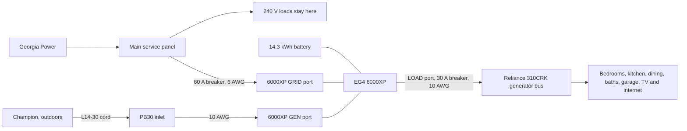

# System schematic

The Reliance 310CRK remains the distribution equipment for the ten circuits. The inverter load port feeds that switch on its generator bus through a 30 A breaker. The Champion inlet feeds the inverter generator port and does not land on the Reliance.

## Connections

- Georgia Power feeds the main service panel. Range, dryer, water heater, and central air stay on that panel.
- A new 60 A two-pole breaker in the main panel feeds the inverter GRID port with L1, L2, neutral, and ground, in 6 AWG copper. The breaker matches the panel brand.
- The Champion stays outdoors and plugs into the existing PB30 inlet. The inlet conductors move off the Reliance and land only on the inverter GEN port, in 10 AWG.
- The 14.3 kWh wall battery connects to the inverter on the factory DC cables. Its 200 A BMS supplies the inverter. The emergency-shutdown initiator is on the battery communications circuit.
- The inverter LOAD port feeds a 30 A two-pole breaker, then the Reliance generator lugs, with L1, L2, neutral, and ground, in 10 AWG. That bus is rated 30 A.
- The ten toggles stay on GEN. A toggle returned to LINE puts that one circuit back on its main-panel breaker.

## What the Reliance does

Each toggle picks up a breaker already in the main panel. On LINE, that breaker feeds the room through the Reliance breaker. On GEN, the toggle disconnects that main-panel breaker and feeds the room from the generator bus.

With the toggles on GEN, the generator bus is fed by the inverter, so the rooms are on the UPS with the utility present and during an outage. The main-panel breakers for those circuits remain, and they are not the backup source while the toggles are on GEN.

## Single neutral bond

The service panel keeps the only neutral-to-ground bond. The Reliance neutral is not switched. The inverter internal bond is disabled. The generator neutral is floating.
