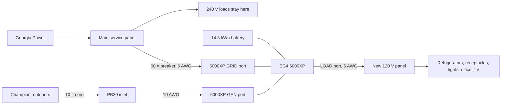

# System schematic

Planned interconnections for the 120 V backup. The Champion inlet never lands in the service panel. The inverter load port is the only source for the new panel.

## Connections

- Georgia Power feeds the main service panel. Range, dryer, water heater, and central air stay on that panel and are off during an outage.
- A new 60 A two-pole breaker in the main panel feeds the inverter GRID port with L1, L2, neutral, and ground, in 6 AWG.
- The Champion stays outdoors and plugs into the existing PB30 inlet. That inlet feeds only the inverter GEN port, in 10 AWG.
- The 14.3 kWh wall battery connects to the inverter on DC positive and negative. Its 200 A BMS can supply the inverter by itself.
- The inverter LOAD port feeds the new 120 V panel with L1, L2, neutral, and ground, in 6 AWG. Neutral and ground are separated in that panel. The neutral-ground bond stays in the main panel.
- The room wires that leave the Reliance switch today move to that new panel. Put one refrigerator on each 120 V leg.

## What the Reliance does today

Each toggle picks up a breaker already in the main panel. On utility, that breaker feeds the Reliance LINE side, then the Reliance breaker, then the room. On generator, the toggle disconnects that main-panel breaker and feeds the room from the inlet.

Those 15 A and 20 A breakers stay in the main panel and are not bought again. The Reliance 310CRK comes out of the backup path and is not left in series with the inverter.
